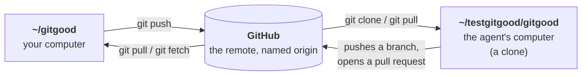

# You need to learn Git RIGHT NOW!!

**The companion guide to the NetworkChuck video.** 
Build a tiny repo, save it, break it, time travel, branch off the sacred timeline, put it on GitHub, and hand real work to an AI agent through issues and pull requests. Every command, in the order the video runs them.

▶ Watch the video: link coming the day it goes live

 

---

## What is Git?

Git is the save-game feature for your files. Every time you **commit**, Git takes a save point of your whole folder, and you can go back to any save point later. It runs on your computer, in a hidden `.git` folder inside your project. Linus Torvalds wrote it (yes, the Linux guy).

**Git is not GitHub.** Git is the tool. GitHub is a website that stores a copy of your Git repo in the cloud and adds team features on top, like issues and pull requests. GitLab, Bitbucket and self-hosted servers like Gitea do the same job. You'll use Git alone for the first half of this guide and only touch GitHub in chapter 5.

## Why now?

AI agents write a lot of code now, and they use Git to do it. They make branches, commit, push, and open pull requests for you to merge. If you know what those words mean, you can check their work, undo their mistakes, and stop them before they wreck `main`. Git isn't only for code either: anything that lives in files (notes, configs, a workout log) can be tracked the same way.

## What you'll build

One small project in two folders, plus a copy on GitHub. The second folder plays the part of your AI agent's computer.

The project itself is two files: `index.html` (a basic web page) and `zombiestory.md` (a zombie story). What you write in them doesn't matter. Starters are in [`examples/`](examples).

## The path

Follow it in order. The times are where each part starts in the video.

| # | Chapter | Video | What you'll do |
|---|---------|-------|----------------|
| 1 | [Install Git and make your first repo](guide/01-install-and-first-repo.md) | 3:01 | Install Git, set your name, `git init`, `git add`, your first commit |
| 2 | [See changes, undo them, time travel](guide/02-diff-restore-time-travel.md) | 7:28 | `git diff`, staging, `git restore`, `git checkout` an old commit, back with `git switch` |
| 3 | [Branches](guide/03-branches.md) | 11:07 | Make an alternate timeline, commit on it, merge it into `main`, delete it |
| 4 | [Put it on GitHub](guide/04-github.md) | 15:13 | GitHub CLI, a private repo, `.gitignore` for secrets, `push`, `clone`, `pull` |
| 5 | [Hand issues to an AI agent](guide/05-issues-and-your-agent.md) | 22:06 | Create issues, have your agent work one on a branch, `git fetch` its work |
| 6 | [Pull requests](guide/06-pull-requests.md) | 27:05 | The agent opens a PR, you check it out, merge it on the web and from the CLI |
| 7 | [Merge conflicts and revert](guide/07-conflicts-and-revert.md) | 31:01 | Cause a conflict on purpose, resolve it on GitHub, undo a merged PR |
| 8 | [Troubleshooting](guide/08-troubleshooting.md) | | Every error hit while filming, and the fix |

Short on time? The [cheat sheet](guide/cheatsheet.md) has every command on one page.

## Before you start

- **A terminal.** Mac Terminal, Linux, or Windows with Git Bash or WSL2.
- **Git.** Chapter 1 shows how to check and install it.
- **A free GitHub account** for chapters 4 to 7: [github.com](https://github.com).
- **An AI coding agent** for chapters 5 to 7, one that can run commands in your terminal (Claude Code, Codex, Copilot CLI, Gemini CLI, anything like that). It uses the same Git and GitHub login you do.

> [!NOTE]
> **Tested on Git 2.50 and GitHub CLI 2.83** (November 2026). The video was filmed on a Mac. Every Git command here works the same on Linux and Windows.

> [!TIP]
> Read diffs by the **`+`** and **`-`** at the start of each line, not by color. `+` is a line that was added, `-` is a line that was removed. Colors change between terminals; the signs never do.

## Links

- 🛠️ Download Git: [git-scm.com/downloads](https://git-scm.com/downloads)
- 🛠️ GitHub CLI: [cli.github.com](https://cli.github.com)
- 🌐 GitHub (free account): [github.com](https://github.com)
- 📖 The free Pro Git book: [git-scm.com/book](https://git-scm.com/book)

## Sponsor

The video was sponsored by **CodeRabbit**, an AI code reviewer that reads every file in a pull request, including the ones your AI agent wrote, and tells you what it changes and what it breaks before you click merge. You'll meet pull requests in [chapter 6](guide/06-pull-requests.md).

**Start a free 14-day CodeRabbit trial** (no credit card): [ntck.co/coderabbit](https://ntck.co/coderabbit)

## License

This guide is [MIT licensed](LICENSE). Git and the GitHub CLI are separate projects with their own licenses.
