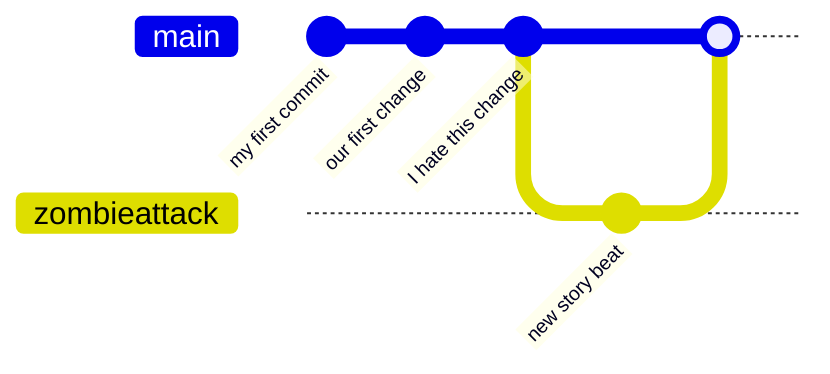

# 3. Branches

**Video:** 11:07 to 15:13
**What you'll do:** branch off the sacred timeline, make a change in that alternate reality, jump between the two, then merge it back into `main` and clean up.

## What a branch is

`main` is your **sacred timeline**: the version of your project you trust. A **branch** is an alternate timeline that splits off from it. You (or your AI agent, or another person) can make big, risky changes on the branch, and `main` doesn't feel a thing. If the changes turn out good, you merge them into `main`. If they don't, you throw the branch away.

`main` is a branch too. It's just the main one.



## Step 1: See your branches

```bash
git branch
```

```
* main
```

One branch. The `*` marks the one you're on.

## Step 2: Create a branch

```bash
git branch zombieattack
git branch
```

```
* main
  zombieattack
```

The branch exists, but the `*` is still on `main`. Creating a branch doesn't move you into it.

## Step 3: Switch to it

```bash
git switch zombieattack
git branch
```

```
Switched to branch 'zombieattack'
  main
* zombieattack
```

Look around:

```bash
ls
git log --oneline
```

Same files, same commits. A new branch starts as an exact copy of the one you branched from. Both timelines point at the same commit, until you change something.

> [!TIP]
> `git switch -c zombieattack` creates the branch **and** switches to it in one command. You'll see agents use that a lot.

## Step 4: Change the story on the branch

```bash
nano zombiestory.md
```

Add a new story beat at the end, save, and check the difference:

```bash
git diff
```

```diff
 It was a dark, stormy night in Resident Evil land.
 Hey it's a zombie story
 I hate this change
+The zombies broke through the front door.
```

Lines with a space at the start didn't change. The `+` line is new.

## Step 5: Commit it on the branch

```bash
git add .
git commit -m "new story beat"
git log --oneline
```

```
cb1843c (HEAD -> zombieattack) new story beat
0f5861c (main) I hate this change
15271c9 our first change
6933913 my first commit
```

`zombieattack` is now one commit **ahead** of `main`. The story is different in this timeline.

## Step 6: Jump between the timelines

```bash
git switch main
cat zombiestory.md
git log --oneline
```

On `main`, the new story beat isn't there, and the `new story beat` commit isn't in the log. Completely different dimension. Jump back:

```bash
git switch zombieattack
git log --oneline
```

And it's back.

## Step 7: Merge the branch into main

You like the new story beat. Make it part of the sacred timeline. First go to the branch you want to merge **into**:

```bash
git switch main
git merge zombieattack
```

```
Updating 0f5861c..cb1843c
Fast-forward
 zombiestory.md | 1 +
 1 file changed, 1 insertion(+)
```

**Fast-forward** means `main` hadn't changed since the branch split off, so Git just slid `main` forward to the branch's newest commit. No new commit needed.

```bash
git log --oneline
```

```
cb1843c (HEAD -> main, zombieattack) new story beat
0f5861c I hate this change
...
```

Both timelines line up on the same commit. This is exactly what your AI agent does when it makes a feature on a branch and merges it.

## Step 8: Delete the branch

`zombieattack` has nothing `main` doesn't have now. Delete it:

```bash
git branch -d zombieattack
git branch
```

```
Deleted branch zombieattack (was cb1843c).
* main
```

The commit isn't gone. It's part of `main` now. Only the branch's name was deleted.

> [!NOTE]
> `-d` (lowercase) refuses to delete a branch that has commits `main` doesn't have yet, so you can't lose work by accident. `-D` (uppercase) deletes it anyway. Be careful with that one.

**Next:** [4. Put it on GitHub](04-github.md)
