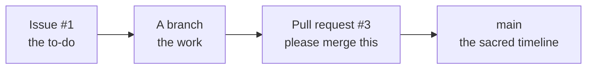

# 6. Pull requests

**Video:** 27:05 to 31:01
**What you'll do:** have your agent open a pull request, look at it from the CLI and the website, test it with `gh pr checkout`, then merge one PR on the website and another from the terminal.

## What a pull request is

You could merge the agent's branch yourself with `git merge`, like you did in chapter 3. Most teams don't. They open a **pull request** (PR): a request to merge one branch into another, usually into `main`. It shows exactly what changed, gives people (and review tools) a place to comment, and puts one button between the change and your sacred timeline.

Like issues, pull requests are a **GitHub** feature, not Git. GitLab calls the same thing a **merge request**, which is honestly the better name.

The usual flow, with or without an agent:



## Step 1: Have the agent open a PR

Make sure your own folder is on `main`:

```bash
cd ~/gitgood
git switch main
```

Then go back to the agent's computer and pick its conversation back up:

```bash
cd ~/testgitgood/gitgood
```

Start your agent (resume the last conversation if it can) and tell it:

> Create a pull request for that branch.

Watch the command it runs: `gh pr create`, usually with a title, a body, and `--base main`. When it finishes it prints the PR's address.

**Why is it #3, not #1?** Issues and pull requests share one numbering system in a repo. You made issues #1 and #2, so the first PR is #3.

## Step 2: Look at the PR

From the terminal:

```bash
gh pr list
gh pr view 3
```

The details say what it changes, and usually a line like **Closes #1**. That links the PR to the issue: when the PR is merged, GitHub closes issue #1 for you.

On the website, open your repo and click **Pull requests**. There's a big green **Merge pull request** button. Don't click it yet.

> [!TIP]
> This is the moment that matters with AI agents: you're the one who clicks merge. A one-line change is easy to read. A 4,000-line change across 43 files is not. That's the problem the video's sponsor, [CodeRabbit](https://ntck.co/coderabbit), solves: it reviews every file in the PR and tells you what it changes and what it might break.

## Step 3: Test the PR on your computer with `gh pr checkout`

Back in your folder:

```bash
cd ~/gitgood
gh pr checkout 3
```

This does what you did by hand in chapter 5 (`git fetch`, then `git switch` to the agent's branch) in one command, using the PR number instead of the branch name.

```bash
git log --oneline
cat zombiestory.md
```

The agent's line is there. This is where you'd run the app and test it. Then go back:

```bash
git switch main
```

## Step 4: Merge it on the website

On the PR's page:

1. Click **Merge pull request**.
2. Leave the message as it is and click **Confirm merge**.
3. GitHub says the pull request was successfully merged and closed. Click **Delete branch** to clean up the agent's branch.

Open `zombiestory.md` on GitHub: the new line is in `main`. Check **Issues**: #1 is closed.

## Step 5: Pull the merge down

The merge happened on GitHub, so your computer doesn't have it yet:

```bash
cat zombiestory.md
git pull
cat zombiestory.md
git log --oneline
```

The top commit is the merge of pull request #3. The agent's work is on the sacred timeline.

## Step 6: Do it again, all from the terminal

Hand the agent issue #2 (the Japanese translation) and let it go all the way this time. In the agent's folder:

```bash
cd ~/testgitgood/gitgood
git pull
```

> Work issue #2 on a new branch and create a pull request.

Then test it from your folder (the video's was PR #4; use the number your agent prints):

```bash
cd ~/gitgood
gh pr checkout 4
ls
```

There's a new file with the Japanese story. Read it with `cat`. Like it? Merge it from the CLI:

```bash
git switch main
gh pr merge 4 --merge
ls
```

The Japanese file isn't in your folder yet, because the merge happened on GitHub. Pull it:

```bash
git pull
ls
git log --oneline
```

There it is.

| `gh pr merge` option | What it does |
|---------------------|--------------|
| `--merge` | Keeps every commit from the branch and adds a merge commit (what the video uses) |
| `--squash` | Squashes the branch into one commit on `main` |
| `--rebase` | Replays the branch's commits on top of `main`, no merge commit |
| `--delete-branch` | Also deletes the branch after merging |

**Next:** [7. Merge conflicts and revert](07-conflicts-and-revert.md)
