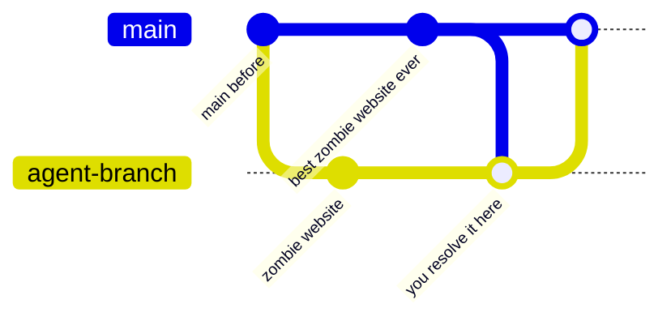

# 7. Merge conflicts and revert

**Video:** 31:01 to 35:34
**What you'll do:** commit a timeline crime on purpose (you and your agent change the same file at the same time), see the merge fail, resolve the conflict on GitHub, merge, and then undo the whole merge with one click.

## Step 1: The agent starts a change

On the agent's computer, get up to date and give it a new job:

```bash
cd ~/testgitgood/gitgood
git pull
gh issue create --title "Zombie website" --body "Make index.html into a real zombie website"
```

Then tell your agent:

> Work the new issue on a new branch and create a pull request.

In the video that was issue #5 and the agent opened PR #6. Use your own numbers from here on.

## Step 2: Meanwhile, you change the same file on `main`

While that PR sits waiting, make your own change to the same file, in your own folder:

```bash
cd ~/gitgood
nano index.html
```

Add a line at the end:

```
The best zombie website ever
```

Save, then stage, commit, and push it straight to `main`:

```bash
git add .
git commit -m "best zombie website ever"
git push
```

## Step 3: Look at what the agent built

```bash
git fetch
git branch -a
git switch <the agent's branch>
```

Open the page in your browser to see it (`open index.html` on a Mac, `start index.html` on Windows, `xdg-open index.html` on Linux). Then come back:

```bash
git switch main
```

## Step 4: Try to merge, and get caught

```bash
gh pr merge 6 --merge
```

It refuses: the pull request **is not mergeable**. You've committed a timeline crime.

**Why:** when the agent branched, it copied `main` as it was. Then you added a commit to `main` that the agent's branch knows nothing about, and both of you changed `index.html` in the same spot. Git can't know which version you want, so it won't guess.



This is completely normal. It happens all the time on any project with more than one person or agent working on it.

## Step 5: Resolve the conflict on GitHub

1. On GitHub, click **Pull requests** and open the agent's PR.
2. Near the bottom it says **This branch has conflicts that must be resolved**. Click **Resolve conflicts**.
3. GitHub opens an editor showing both versions of the conflicting lines, between markers like these:

```
<<<<<<< the-agents-branch
...the agent's new website...
=======
The best zombie website ever
>>>>>>> main
```

Above each conflict are three choices:

| Button | Keeps |
|--------|-------|
| **Accept current change** | The top version (the agent's branch) |
| **Accept incoming change** | The bottom version (`main`, your line) |
| **Accept both changes** | Both, one after the other |

The video picks **Accept both changes**, so the page keeps the agent's website and your line at the bottom. You can also just type the file the way you want it. Whatever's left in the editor is your decision.

4. Click **Mark as resolved** (top right), then **Commit merge**.
5. The PR now says there are no conflicts with the base branch. Click **Merge pull request**, then **Confirm merge**.

## Step 6: Pull it down

```bash
git pull
git log --oneline
```

The timeline is getting busy. The top commit is the merge of the agent's PR.

## Step 7: Undo a merge with revert

What if you merge it and then hate it? You can undo a merged PR without erasing any history.

1. On GitHub, click **Pull requests**.
2. Clear the filter in the search box (it starts as `is:pr is:open`) and click **Closed**.
3. Open the PR you just merged and click **Revert**.
4. GitHub opens a **new** pull request that undoes the old one. Click **Merge pull request**, then **Confirm merge**.

Pull it down:

```bash
git pull
git log --oneline
```

The website is back to how it was. The revert is a new commit on top, and the original merge is still underneath it. That's the save-game idea again: you don't delete save points, you make a new one that puts things back.

---

## Bonus: do it all from the terminal

> [!NOTE]
> Not in the video. Same results, no website, for when your agent hits a conflict and you want to see it yourself.

**Resolve a conflict locally.** On `main`, merge the agent's branch directly:

```bash
git fetch
git merge origin/<the agent's branch>
```

```
Auto-merging index.html
CONFLICT (content): Merge conflict in index.html
Automatic merge failed; fix conflicts and then commit the result.
```

Changed your mind? Back out completely:

```bash
git merge --abort
```

Or fix it. Open the file:

```bash
nano index.html
```

```
<<<<<<< HEAD
The best zombie website ever
=======
<h1>THE ZOMBIE WEBSITE</h1>
>>>>>>> origin/the-agents-branch
```

`HEAD` (top) is your side, the bottom is theirs. Edit it to what you want, and **delete the three marker lines** (`<<<<<<<`, `=======`, `>>>>>>>`). Then:

```bash
git add index.html
git commit --no-edit
git push
```

Because the agent's commits are now in `main`, GitHub marks its PR as merged on its own.

**Revert a merge locally.** Find the merge commit's hash with `git log --oneline`, then:

```bash
git revert -m 1 --no-edit <merge-hash>
git push
```

`-m 1` means "put it back the way `main` looked before this merge."

**Next:** [8. Troubleshooting](08-troubleshooting.md)
